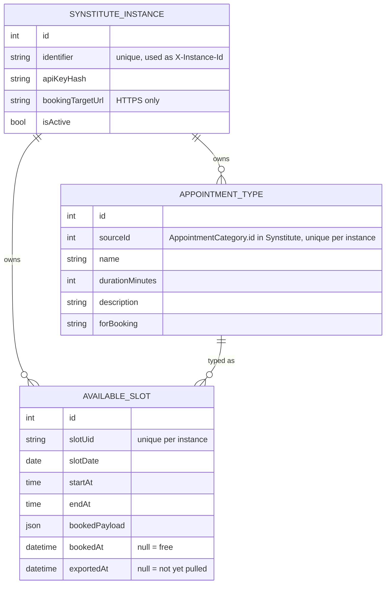
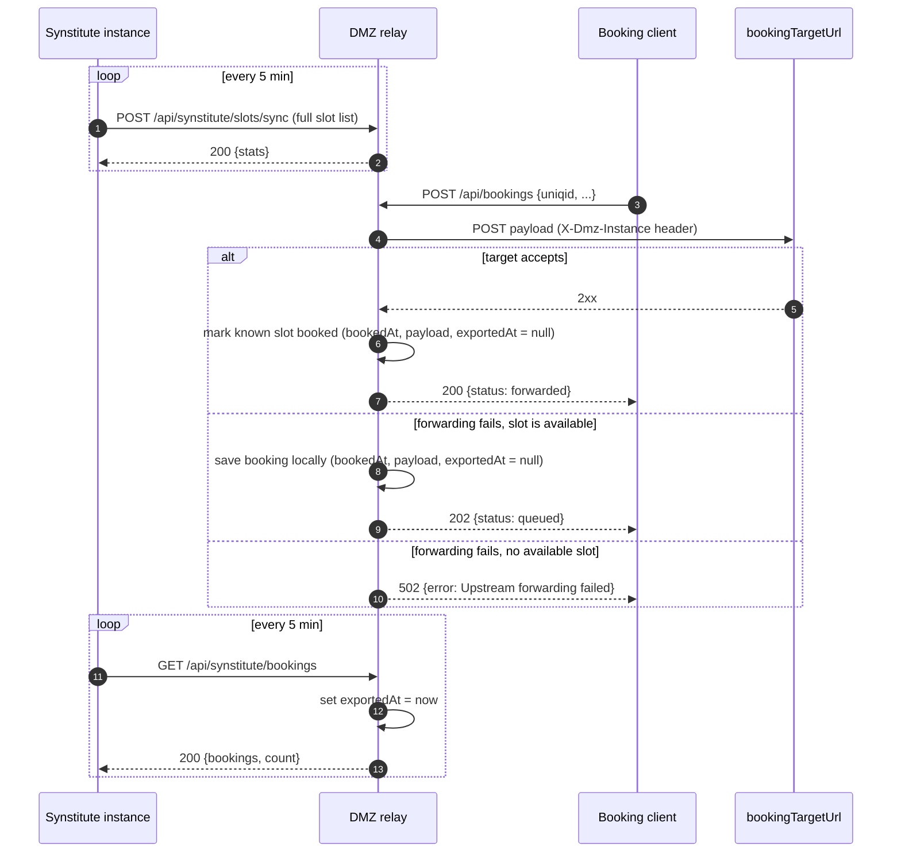

# Slot Synchronisation & Booking Flow

This document describes how available slots move between a **Synstitute instance** (the internal system) and the **DMZ relay**, and how bookings travel back.

## Actors

| Actor | Role |
|---|---|
| **Synstitute instance** | Internal system that owns the calendar. Pushes available slots and pulls bookings. |
| **DMZ relay** (this app) | Publicly reachable buffer. Stores slots, forwards bookings, queues them for pickup. |
| **Booking client** | Frontend/integration that books a slot through the DMZ on behalf of an instance. |
| **Operator** | Person who views bookings in the browser. |

## Data model



A slot's state is derived from `bookedAt` and `exportedAt`:

| `bookedAt` | `exportedAt` | State |
|---|---|---|
| `null` | `null` | **Free**: may be removed by the next sync |
| set | `null` | **Booked, pending export**: returned by the next pull |
| set | set | **Booked, exported**: already delivered to the instance |

## 1. Onboarding an instance

```bash
php bin/console app:instance:create <identifier> <https_booking_target_url>
```

- `identifier`: `[A-Za-z0-9._-]{3,64}`, used as the `X-Instance-Id` header and as the username for the web view.
- `bookingTargetUrl`: must be HTTPS. Bookings are forwarded here.
- The command prints the **API key once**. Only its hash is stored.

The numeric database `id` of the instance is needed for the web view (`/view/bookings/{id}`).

Instances can also be created and managed from `/admin`, using a separate administrator
account. See [administrator setup](../README.md#instance-administration).
This interface does not expose bookings or customer data. It permits status changes,
booking target changes, and API key rotation; the instance identifier cannot be changed.
Both the admin and CLI require a public HTTPS booking target on port 443, without URL
credentials or a fragment. The target is checked again before forwarding, and redirects
are not followed.

## 2. Authentication (Synstitute `/api/*` calls)

Every authenticated Synstitute API request needs these headers:

| Header | Rule |
|---|---|
| `X-Instance-Id` | Instance identifier |
| `X-Api-Key` | API key (24–255 chars) |
| `X-Request-Timestamp` | Unix timestamp (10 digits), max ±300 s drift |
| `X-Request-Id` | `[A-Za-z0-9-]{12,128}`, **unique per request** (replays rejected for 10 min) |
| `Content-Type` | `application/json` for POST requests |

HTTPS is mandatory unless `APP_ENV=dev` **and** `APP_ALLOW_INSECURE=1`.

The website-facing routes under `/api/public/` are public and do not accept or require the Synstitute API key. They still require HTTPS outside development.

## 3. End-to-end flow



### 3.1 Slot sync: `POST /api/synstitute/slots/sync`

The body is either `{"slots": [...]}` or a bare array of slots. Max body size: 1 MiB.

#### Appointment category catalogue

`PatientAppointment.appointmentType` references `AppointmentCategory` in the online-calendar
bundle. The DMZ mirrors that category in its existing `appointment_type` table; its local
primary key is **not** the category ID used by Synstitute.

Before sending slots, Synstitute can push its catalogue using the authenticated endpoint
`POST /api/synstitute/appointment-categories/sync`:

```json
{
  "appointmentCategories": [
    {
      "id": 41,
      "name": "Initial consultation",
      "durationMinutes": 30,
      "description": "First patient visit",
      "forBooking": "Bring your referral"
    }
  ]
}
```

A bare category array is also accepted. Categories are upserted by `(instance, source ID)`;
renaming a category does not change its identity, and distinct IDs may share a name and
duration. `id` and `durationMinutes` must be positive JSON integers, `name` must be non-empty
and at most 255 characters. `description` and `forBooking` are nullable strings.
An invalid category batch returns HTTP 400 before writing any categories. Categories are
not deleted when omitted; this endpoint is an upsert, not a replacement snapshot.
For source-ID categories, omitted `description`/`forBooking` fields retain their existing
values; send explicit `null` to clear them. Minimal inline slot metadata therefore does
not erase booking information from the catalogue.

Response: `{"status":"ok","stats":{"received":1,"synchronized":1}}`.

Alternatively include `appointmentCategories` alongside `slots` in a slot-sync request.
The categories are synchronized first, and their stats appear under
`stats.appointmentCategories`. The categories are then available for slot references:

```json
{
  "slots": [
    {
      "uniqid": "slot-abc-123",
      "date": "2026-08-03",
      "startAt": "09:00",
      "endAt": "09:30",
      "appointmentType": {"id": 41}
    }
  ]
}
```

An integer `appointmentType: 41` is also accepted. Unknown category references are skipped,
using the existing invalid-slot accounting.
An inline category object can include `id`, `name`, `durationMinutes`, `description` and
`forBooking`; it is upserted by source ID. Existing slot payloads without a source ID
remain supported:

```json
{
  "slots": [
    {
      "uniqid": "slot-abc-123",
      "date": "2026-08-03",
      "startAt": "09:00",
      "endAt": "09:30",
      "appointmentType": {
        "string": "Initial consultation",
        "duration": 30,
        "description": "First patient visit"
      }
    }
  ]
}
```

Accepted field variants:

- Slot id: `uniqid` or `slotUid`.
- Appointment type as an object: `string` or `name`, plus `duration` or `durationMinutes` and an optional `description`.
- Appointment type as a string: `"appointmentType": "Initial consultation"` with `duration` and `description` on the slot itself.

**Processing rules** ([SlotSyncService](../src/Service/SlotSyncService.php)):

1. **Validation**: a slot is **silently skipped** if the uid, date (`Y-m-d`), `startAt`/`endAt` (`H:i`), or type name is missing or malformed, or if `duration <= 0`.
2. **Appointment types** with a source ID are upserted by `(instance, source ID)`. Legacy types without an ID are upserted by `(instance, name, duration)`. Metadata is updated. Types are never deleted.
3. **Slots** are upserted by `(instance, slotUid)`. Date, times and type are overwritten only for free slots. Booked slots retain their reserved date, times and type; booking data is **not** touched.
4. **Removal**: the sync is a **full snapshot**. Free slots (`bookedAt IS NULL`) whose uid is not in the payload are deleted. Booked slots are always kept.

Response:

```json
{ "status": "ok", "stats": { "received": 12, "inserted": 3, "updated": 8 } }
```

`received - inserted - updated` gives the number of skipped (invalid) entries.

> **Important:** if the payload contains **no valid slot** (empty list or all invalid), the removal step is skipped and **existing free slots stay in place**. Sending `[]` does not clear the calendar.

### 3.2 Booking forward: `POST /api/bookings`

The booking client sends any JSON object. It should contain `uniqid` or `slotUid`.

**Processing rules** ([BookingForwarder](../src/Service/BookingForwarder.php)):

1. The target URL must be HTTPS, and all of its DNS A/AAAA records must be public IPs (SSRF protection).
2. For a known slot, `appointmentType` is filled from the DMZ catalogue before forwarding. If supplied, it must be the source category ID (an integer or an object with integer `id`) of that slot; otherwise HTTP 400 is returned without forwarding. Client-provided type metadata is replaced with authoritative catalogue data. The enriched payload is POSTed to `bookingTargetUrl` with the header `X-Dmz-Instance: <identifier>`. Timeout: 10 s.
3. If forwarding fails (including target validation failure, an unreachable target or a non-2xx response), an existing future, unbooked slot is saved locally for Synstitute pickup. The response is `202 {"status": "queued", "upstreamStatus": n}`. If no such slot exists, the DMZ still returns `502 {"error": "Upstream forwarding failed", "upstreamStatus": n}`; it cannot safely queue an unknown, past or already-booked slot.
4. On 2xx, if the slot uid exists for this instance, the slot gets `bookedAt = now` and `bookedPayload = payload`, and `exportedAt` is reset to `null`.
5. If the uid is missing or unknown, a legacy payload without `appointmentType` is still forwarded but **not recorded** in the DMZ. An explicit type requires a known slot and is otherwise rejected with HTTP 400.

### 3.3 Website routes

The customer website can call these routes without Synstitute credentials. Replace `{instance_identifier}` with the identifier used when onboarding the Synstitute.

#### Read appointment types: `GET /api/public/synstitutes/{instance_identifier}/appointment-types`

Returns the synchronized categories of that active instance, including categories with no
currently available slots. Legacy types without a source ID are not included.

```json
{
  "appointmentTypes": [
    {
      "id": 41,
      "name": "Initial consultation",
      "durationMinutes": 30,
      "description": "First patient visit",
      "forBooking": "Bring your referral",
      "string": "Initial consultation",
      "duration": 30
    }
  ],
  "count": 1
}
```

`id` always identifies the source `AppointmentCategory`, never a DMZ primary key.
The legacy `string` and `duration` fields are kept for existing Synstitute importers.
Available-slot responses include this same type object. The website can offer a type
selector and then select slots whose `appointmentType.id` matches the chosen category.

#### Read available slots: `GET /api/public/synstitutes/{instance_identifier}/slots`

Returns future, unbooked slots for that active Synstitute. The response omits internal booking data:

```json
{
  "slots": [
    {
      "uniqid": "slot-abc-123",
      "date": "2026-08-03",
      "startAt": "09:00",
      "endAt": "09:30",
      "appointmentType": {
        "string": "Initial consultation",
        "duration": 30,
        "description": "First patient visit"
      }
    }
  ],
  "count": 1
}
```

#### Make a reservation: `POST /api/public/synstitutes/{instance_identifier}/bookings`

Send the booking payload expected by the Synstitute booking target, including the selected slot's `uniqid` (or `slotUid`), as JSON. The DMZ rejects unknown, past, or already-booked slots with `409` and attempts to forward valid payloads. It records the booking even if forwarding fails, so Synstitute can fetch it through `GET /api/synstitute/bookings`. The slot is no longer available to other customers.

Both outcomes return HTTP `201`: `{"status": "forwarded", "upstreamStatus": n}` when the target accepts the POST, or `{"status": "queued", "upstreamStatus": n}` for local fallback. `queued` means stored pending Synstitute pickup, not confirmed by the upstream system. An upstream status of `0` means no HTTP response was obtained. Fallbacks are logged at warning level without booking payloads or customer data.

A failed connection can have an ambiguous outcome: the target may have processed the POST before the connection failed. Synstitute should deduplicate bookings by slot `uniqid` when processing pulled bookings. The DMZ does not automatically retry forwarding.

```json
{
  "uniqid": "slot-abc-123",
  "appointmentType": 41,
  "customer": {
    "name": "Jane Doe",
    "email": "jane@example.com"
  }
}
```

`appointmentType` is optional (defaults to the slot's type), but if supplied must identify
that slot's category. It is forwarded and persisted as the full, authoritative object
shown above, not just the submitted ID. Customer data, including birthdate if supplied,
is preserved unchanged.
For legacy slots without a source category ID, an explicit matching name or a matching
`string`/`duration` (or `name`/`durationMinutes`) object remains accepted.

The Synstitute API key must remain on the server-side integration and must not be embedded in the customer website. For a browser-based website hosted on another origin, configure CORS at the web server or reverse proxy to allow only that website's origin.

### 3.4 Booking pull: `GET /api/synstitute/bookings`

- Returns up to **500** booked slots with `exportedAt IS NULL`, oldest booking first.
- Each returned slot is immediately marked `exportedAt = now`.
- If `count` is `500`, call again until `count < 500`.
- Both top-level `appointmentType` and `payload.appointmentType` contain the category
  snapshot saved at reservation time, including the source ID. Subsequent catalogue or
  slot syncs do not change the booked type metadata or reserved date/times. Bookings
  remain in the database after export; the existing at-most-once pickup behavior is
  unchanged.

```json
{
  "bookings": [
    {
      "uniqid": "slot-abc-123",
      "date": "2026-08-03",
      "startAt": "09:00",
      "endAt": "09:30",
      "appointmentType": { "string": "Initial consultation", "duration": 30, "description": "First patient visit" },
      "bookedAt": "2026-08-01T10:15:00+00:00",
      "payload": { "uniqid": "slot-abc-123", "...": "..." }
    }
  ],
  "count": 1
}
```

### 3.5 Web view: `GET /view/bookings/{id}`

- `{id}` is the numeric instance id.
- Login uses the browser prompt (HTTP Basic): username = instance identifier, password = API key.
- An instance can only see its own bookings (otherwise 403). Inactive instances are rejected.
- The page is **read-only**: it lists all booked slots (exported or not) and does **not** change `exportedAt`.

## 4. Recommended Synstitute client behaviour

1. **Every 5 min, push** the category catalogue with source IDs and booking metadata, then the complete list of free future slots (or send both together). Include every free slot each time, because missing slots are deleted.
2. **Every 5 min, pull** bookings until `count < 500`, and persist them before the next pull.
3. Use a fresh UUID for `X-Request-Id` and the current time for `X-Request-Timestamp` on **every** request. Keep server clocks NTP-synced.
4. Keep `slotUid` stable for the same slot across syncs. A new uid means a new slot.
5. After importing a booking, leave the slot out of future syncs. It stays in the DMZ because it is booked.
6. Resolve `appointmentType.id` to the existing `AppointmentCategory` when importing
   bookings. Source IDs are scoped to the instance. The DMZ cannot add missing fields
   to the internal bundle's serializer: Synstitute must explicitly send duration,
   description and `forBooking` as well as ID/name. The supplied entity's default
   `module_configuration_value:read` group exposes only ID/name.

## 5. Known limitations

- **At-most-once export**: a slot is marked exported before the instance confirms receipt. If the pull response is lost, that booking is not returned again. The web view still shows it.
- **Concurrent booking race**: the website endpoint checks whether a slot is already booked, but simultaneous requests for the same slot are not serialized.
- **Booking clients need instance credentials**: the authenticated `/api/bookings` endpoint uses the same instance API key as the Synstitute endpoints.
- **No timezone handling**: `date`, `startAt` and `endAt` are stored as-is. Both sides must agree on the timezone.
- **Booked slots are never cleaned up** automatically.
- The `requireHttps` column on the instance is not evaluated. HTTPS is enforced globally instead.
